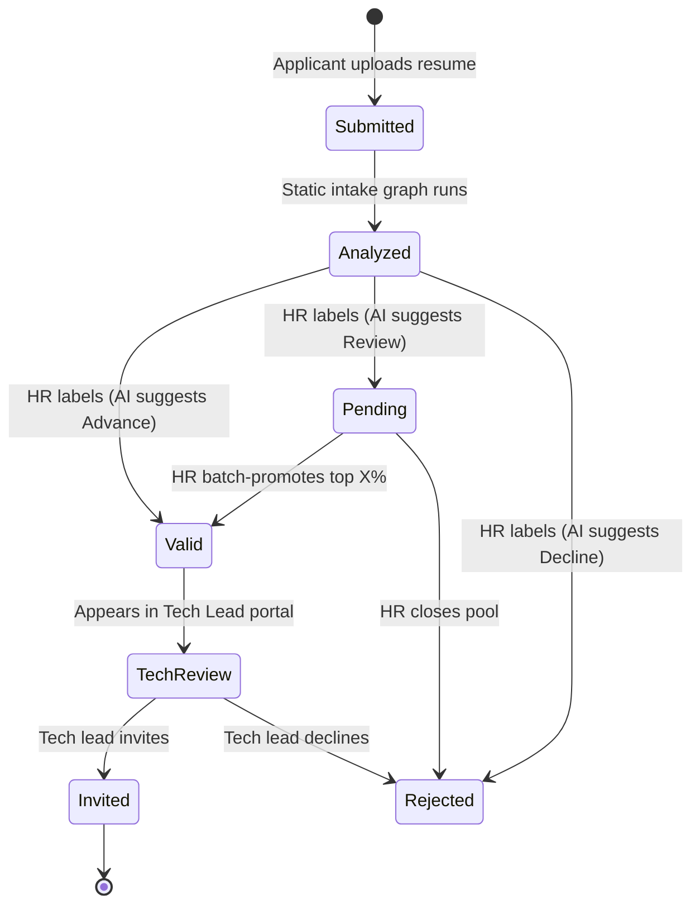

# Rosetta

Evidence-based technical screening for non-technical recruiters.

SkillBridge is a three-portal hiring demo (Applicant → HR → Technical Lead). A LangGraph multi-agent system turns each resume into a **skill profile that is always cited back to a line in the resume**, so a recruiter can understand technical fit in plain language and a technical lead can audit the shortlist in minutes instead of re-screening everyone.

## The problem

Two people in the same hiring pipeline fail each other:

| Who | Pain | Root cause |
|---|---|---|
| **Recruiter / HR** | Cannot tell whether “built ETL in PySpark” satisfies “experience with data pipelines,” or whether “LangChain” implies “agent orchestration.” Falls back on keyword matching. | **Vocabulary gap** — no mapping between how candidates describe skills and how job descriptions require them. |
| **Technical lead** | Receives hundreds of applicants, many keyword-stuffed, and does not trust HR’s shortlist. Re-screens everything. | **Trust gap** — the shortlist has no visible reasoning or evidence. |

Keyword ATS filters make both worse: they reject strong candidates who use different words and pass weak candidates who copy the JD.

**Hypothesis:** if each match decision is grounded in a public skills taxonomy **and** cited to exact resume evidence, HR can screen technical roles confidently and the tech lead can audit instead of redo.

SkillBridge is framed as the missing **Technical Screening** agent next to products like ProCogia’s Haigent: LangGraph orchestration, human-in-the-loop gates, and a full audit trail. The AI **recommends**; people **decide**. There is no autonomous rejection.

## What you see (three portals)

Demo job: ProCogia’s public *AI Intern, Applied & Agentic AI* posting (Vancouver, on-site).

1. **Applicant** — job page, AI-use disclosure, apply form (name, email, optional GitHub/LinkedIn/portfolio, PDF/DOCX resume). Submit stores the file, creates an application, and enqueues the intake graph.
2. **HR** — pipeline table (score, recommendation, confidence, must-have coverage, flags, status). Candidate drawer with a requirement-by-requirement checklist, plain-English explanations, clickable citations that highlight the resume, skill-translation chips, and flags (keyword stuffing, unverifiable claims, prompt injection). Label Valid / Pending / Rejected. Promote top X% of the pending pool with preview → confirm. Recruiter Copilot for questions like “Does she actually know RAG?” or “Compare the top 3 on evaluation experience.”
3. **Technical Lead** — queue of Valid candidates only. Resume + evidence-linked profile, targeted interview questions, rubric grades (AI estimate vs human score), anchored comments, invite (mocked email) or decline.



## How the agents work

**Static intake graph** — same steps on every application:

Ingest & parse → sanitize / injection check → chunk & index (Postgres + Pinecone) → skill extractor → skill normalizer (taxonomy RAG) → requirement matcher (resume RAG, must cite chunk IDs) → scorer → HR explainer → persist profile.

Uncited claims are dropped. Resume text is treated as untrusted data: it is never interpolated into the system prompt.

**Dynamic copilot graph** — a supervisor routes by question type (verify, compare, similar candidates, explain a skill, generate interview questions). Low-confidence verification can call the GitHub public API. A grounding check rejects answers without citations and retries.

**Scoring** is a hybrid of must-have coverage, nice-to-have coverage, resume–JD semantic similarity, and depth (production/project vs list-only), minus stuffing/injection penalties. Thresholds: Advance ≥ 0.70, Review 0.45–0.70, Decline &lt; 0.45 — still only a *recommendation*.

## RAG and data

- **Postgres** is the system of record (applications, chunks, citations, audit events, graph checkpoints).
- **Pinecone** is the derived search index: dense + sparse serverless indexes, hybrid retrieval (RRF), optional rerank. Embeddings via Pinecone Inference (`llama-text-embed-v2`).
- **Taxonomy** from public O*NET / ESCO skills so “PyTorch Lightning” can map to a canonical skill and then to a JD requirement.
- Citations always resolve against Postgres `resume_chunks`, never against Pinecone metadata.

Public seed data: the Greenhouse JD, taxonomy subsets, synthetic (and optionally Kaggle) resumes for a realistic HR pool.

## Guardrails

- Humans confirm every status change; write tools go through a LangGraph interrupt.
- Injection defence before indexing; adversarial resumes are a first-class eval case.
- Blind mode for HR; fairness counterfactuals in the eval harness.
- Applicant disclosure that AI and third-party vector search process the resume.
- Delete purges Postgres **and** Pinecone vectors.
- Full `events` audit log (Langfuse traces planned with the eval harness).

## Stack

| Layer | Choice |
|---|---|
| Frontend | Next.js (App Router) + Tailwind |
| Backend | FastAPI (Python 3.12) + background worker |
| Orchestration | LangGraph, Postgres checkpointer |
| LLMs | Provider abstraction (OpenAI; Anthropic stub) |
| Relational DB | Postgres 16 |
| Vector DB | Pinecone (memory / Pinecone Local / cloud) |
| Packaging | Docker Compose |

## Repo layout

```
apps/web          Applicant / HR / Tech Lead UI
apps/api          FastAPI, LangGraph, RAG, tools
apps/worker       Polls submitted applications and runs intake
data/seed         Seeded JD and resumes
data/taxonomy     O*NET / ESCO skill subset
eval/             Golden set + harness (later milestone)
PRD.md            Source of truth for product scope
```

## Quick start

```bash
cp .env.example .env   # add OPENAI_API_KEY and PINECONE_API_KEY for a live demo
make up
make migrate
make pinecone-init     # when VECTOR_BACKEND=pinecone
make seed
```

`make up-offline` runs with Pinecone Local instead of cloud. Commands, invariants, and env vars are documented in [`agents.md`](agents.md). Current build status is in [`PROGRESS.md`](PROGRESS.md).
